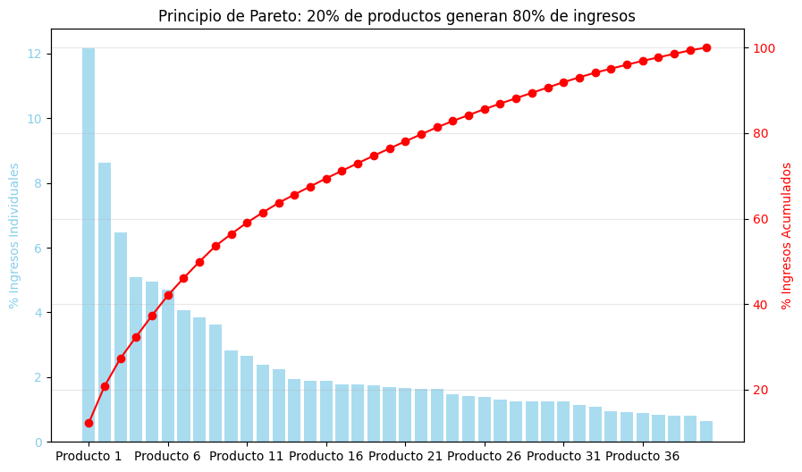
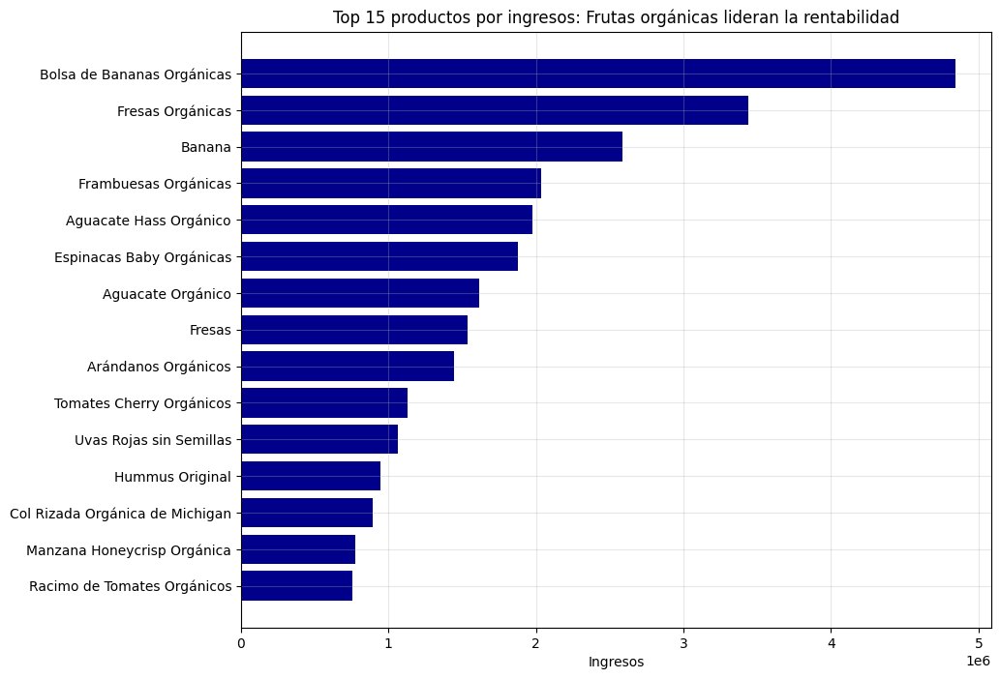
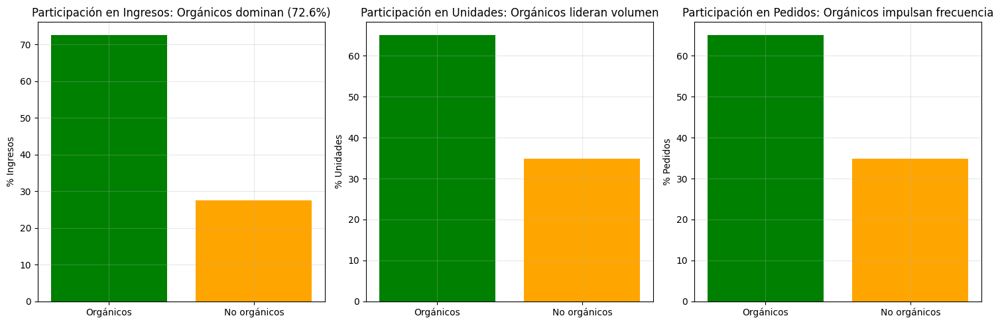

# Análisis de Ventas y Optimización de Surtido — Python + Power BI

🌐 [English](README.md) · **Español**


Análisis exploratorio y visual de tickets de venta reales de una verdulería orgánica, con foco en la **optimización del surtido**: qué productos ampliar, mantener o revisar.

El objetivo es **transformar datos transaccionales en insights accionables de negocio**, respondiendo preguntas como:

- ¿Qué productos generan más ingresos?
- ¿Qué tan rápido rota cada producto?
- ¿Cuáles conviene priorizar, mantener o eliminar del catálogo?

## Resultados principales

Según el notebook (41 productos analizados):

- Los productos orgánicos generan el **72,6 % de los ingresos** y cerca del 65 % de las unidades y los pedidos.
- Los productos **clase A** (análisis ABC) concentran el 80 % de los ingresos y de las unidades.
- **10 productos** son Core Stars / clase A: candidatos a ampliar con más stock y promoción (por ejemplo, las bolsas de bananas orgánicas).
- **1 producto** es Long Tail Weak / clase C: candidato a revisar o sustituir (cebolla roja orgánica).
- El resto es mayormente clase B o nicho premium: conviene monitorear y ajustar precios o hacer cross-sell.

<p align="center">
  
  
</p>
<p align="center">
  
</p>

## Metodología

1. **Limpieza y preparación:** tipos de datos, valores faltantes, variables de fecha (día, mes, año, día de la semana) y validaciones rápidas de calidad, por ejemplo `precio_total ≈ precio_unitario × cantidad`.
2. **Métricas núcleo de surtido por producto:** ingresos, unidades totales, pedidos únicos, clientes únicos, precio promedio, ingreso por pedido, estabilidad mensual (coeficiente de variación) y meses activos.
3. **Rankings ejecutivos:** top 15 de productos por ingresos y por unidades.
4. **Análisis Pareto / ABC:** clase A hasta el 80 % acumulado, B hasta el 95 %, C el resto.
5. **Segmentación 2×2 (ingresos vs rotación):** los puntos de corte son las **medianas**, lo que hace el análisis robusto ante outliers.
6. **Orgánico vs no orgánico:** variable `es_organico` detectada a partir del nombre del producto.
7. **Recomendación final:** tabla por producto que combina clase ABC, cuadrante y una acción sugerida (expandir, monitorear, revisar).

### Segmentación

| Cuadrante (notebook) | Etiqueta en Power BI | Ingresos | Rotación |
|---|---|---|---|
| Core Stars | 🟢 Estrella | Altos | Alta |
| Nicho Premium | 🟡 Premium | Altos | Baja |
| Traffic Builders | 🔵 Volumen | Bajos | Alta |
| Long Tail Weak | 🔴 Baja Prioridad | Bajos | Baja |

## Dashboard en Power BI

`powerbi/dashboard-verduleria.pbix` contiene el dashboard con:

- KPIs: ingresos totales, unidades totales, pedidos totales y productos activos
- Top 10 de productos por ingresos
- Cuadrante 2×2 de surtido (ingresos vs rotación) con medianas y medidas DAX
- Modelo de datos Producto → Ventas y columnas calculadas para la segmentación

## Datos

Los datos de origen (`tickets.csv`) pertenecen a un negocio real y **no se incluyen** en este repositorio. El notebook espera una fila por línea de ticket, con las columnas principales `id_pedido`, `id_cliente`, `id_producto`, `nombre_producto`, `cantidad`, `precio_unitario`, `precio_total` y `fecha`.

## Cómo ejecutarlo

```bash
pip install -r requirements.txt
jupyter notebook eda_tickets.ipynb
```

Colocá tu propio `tickets.csv` junto al notebook. Los gráficos renderizados ya están guardados dentro del notebook, así que se puede revisar el análisis sin ejecutarlo.

## Limitaciones

- No hay datos de costos, por lo que no se pueden calcular márgenes reales.
- No hay datos de inventario (stock, quiebres, lead time).
- Solo granularidad mensual: falta estacionalidad semanal y promociones.
- Muestra limitada de 41 productos.
- La detección de orgánicos se basa en el nombre del producto y puede dar falsos positivos o negativos.

## Próximos pasos

- Agregar el costo unitario para calcular el margen bruto.
- Incluir datos de inventario para optimizar la rotación y evitar quiebres.
- Análisis temporal avanzado: estacionalidad semanal y promociones.
- Segmentación de clientes.
- Pronóstico de demanda.
- Validar las acciones recomendadas con el negocio y medir su impacto en 3–6 meses.

## Autor

**Matías Riffo** — Data Engineer & Backend Developer · Argentina · [GitHub](https://github.com/Mrcipo)

## Licencia

[MIT](LICENSE)
